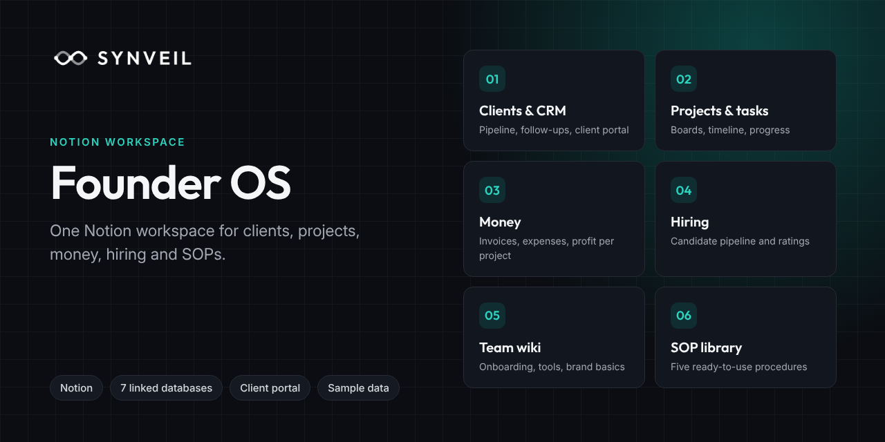
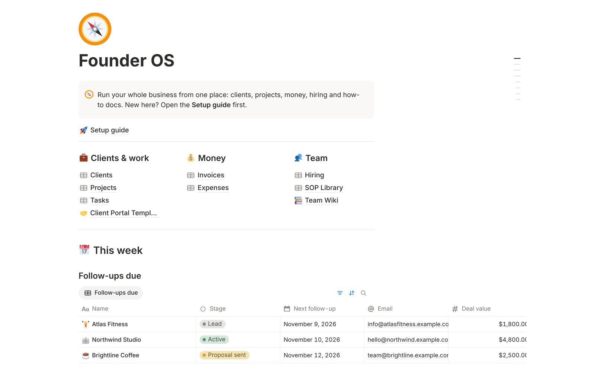
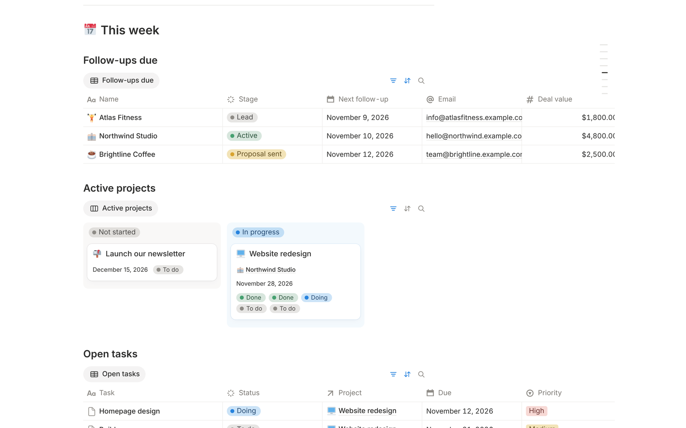
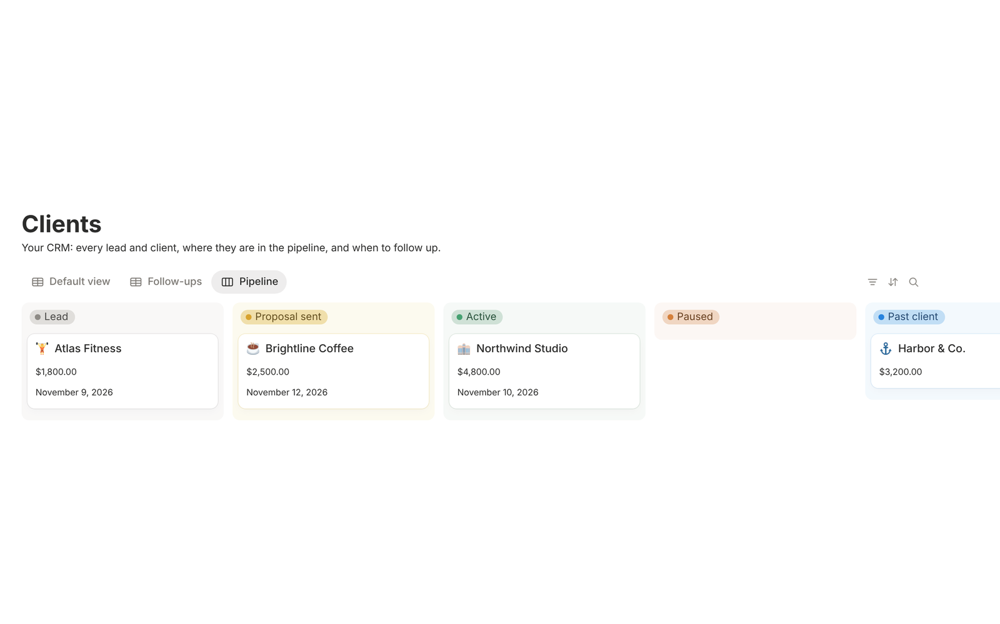
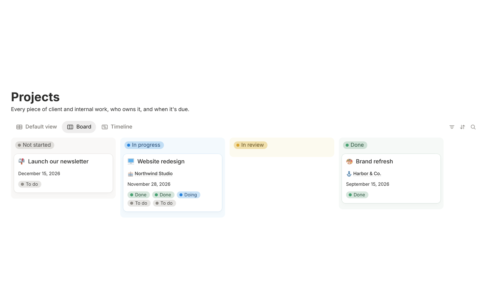
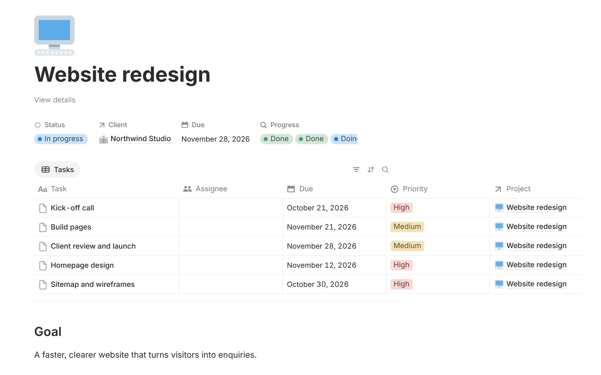
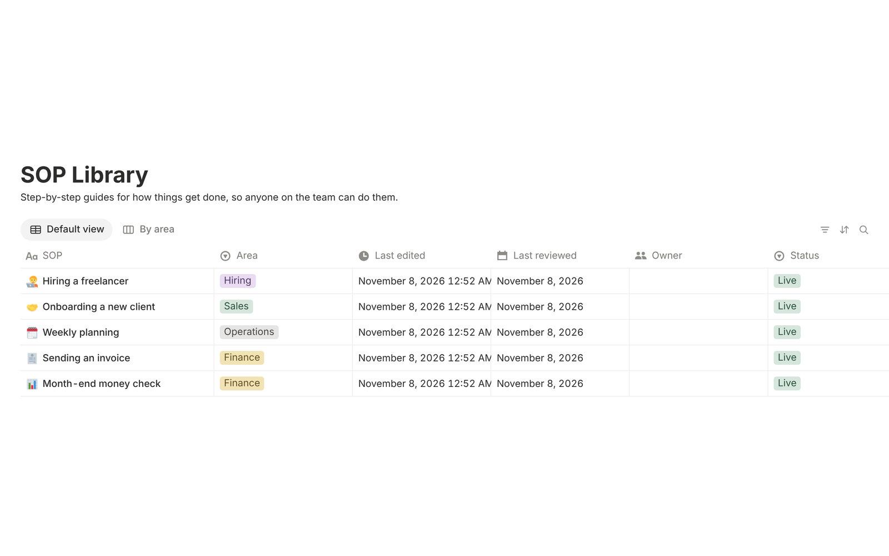
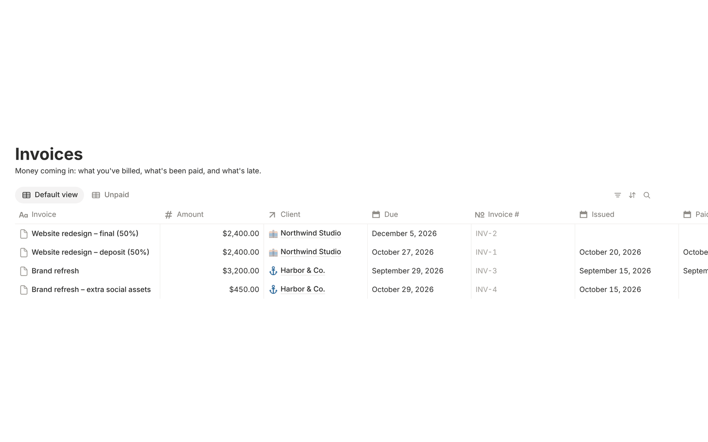
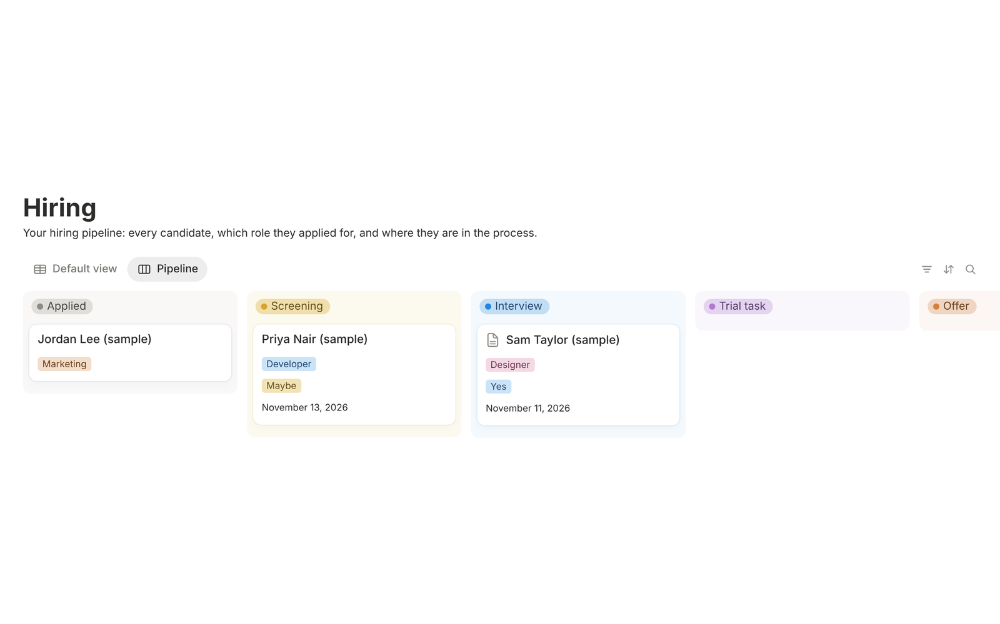

# Founder OS

**One Notion workspace for clients, projects, money, hiring and SOPs.** Seven linked databases and a home dashboard that shows what needs you today.

**$149, one-time** · [**Buy on Whop →**](https://whop.com/synveil/founder-os-92/) · [All Synveil kits](https://synveil.whop.site/)

> This repo is the public page for Founder OS. The Notion template is delivered as a duplicate link when you buy.

## What's inside

**Home dashboard** with links to every part of the system, plus live sections for follow-ups due, active projects, open tasks and unpaid invoices.

| Database | What it tracks |
|---|---|
| **Clients** | Leads and clients, with a pipeline board, follow-ups and total invoiced per client |
| **Projects** | Client and internal work, with board and timeline views, progress, invoiced, spent and profit |
| **Tasks** | To-dos for each project, with a board and a My tasks view |
| **Invoices** | Money coming in, with automatic invoice numbers, a past-due flag and an unpaid view |
| **Expenses** | Money going out, with receipts, recurring costs and spend by category |
| **Hiring** | Candidates by stage, with ratings and CV uploads |
| **SOP Library** | Five ready procedures: client onboarding, sending an invoice, month-end money check, hiring a freelancer and weekly planning |

**Pages:** a setup guide, a client portal template you can share with a client as a guest, and a team wiki (about us, how we work, tools and access, onboarding for new team members, and brand basics).

**Sample data** is included so you can see it working on day one, and it's all marked so it's easy to clear out.

## Screenshots

Taken from the template itself, with its sample data.

| Home dashboard | This week |
|---|---|
|  |  |
| **Clients pipeline** | **Projects board** |
|  |  |
| **A project page** | **SOP Library** |
|  |  |

Invoices and hiring

## How you get it

1. Buy on [Whop](https://whop.com/synveil/founder-os-92/). Access is instant.
2. Open the Founder OS page in your Whop account and click the duplicate link.
3. Choose your Notion workspace. The whole system is copied in, ready to use.
4. Follow the setup guide inside the template.

Also in [Synveil Complete](https://whop.com/synveil/synveil-complete/), the bundle of all five Synveil kits.
